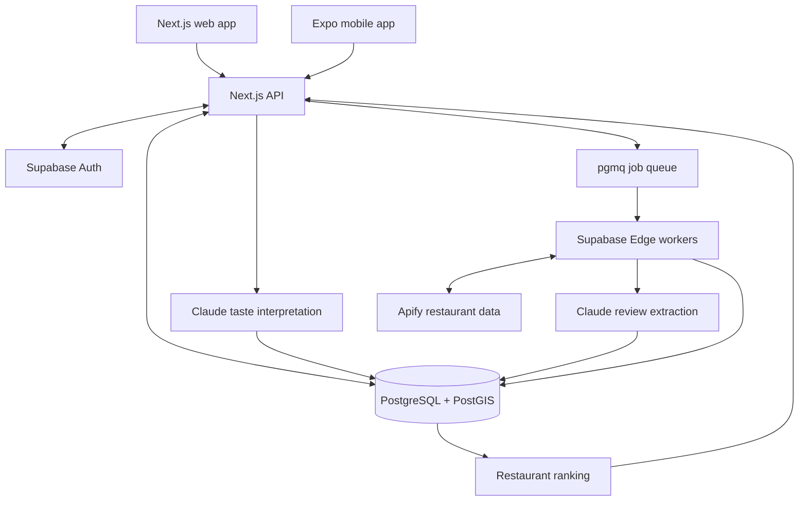

# EastEats

**Discover great East Asian food based on what you actually like, not just star ratings.**

EastEats is a restaurant discovery app that combines real restaurant listings, review-backed food insights, and personalized taste profiles. Explore nearby restaurants, find specific dishes or cuisines, and understand *why* a place might be a good fit for you.

[**Try the web app**](https://easteats.vercel.app) · [Mobile app setup](mobile/README.md) · [Release notes](docs/production-release.md)

## Features

- **Personalized recommendations:** Tell EastEats about your favorite restaurants and what you like about them. AI helps turn those preferences into an editable taste profile.
- **Food-first rankings:** Compare restaurants using evidence about food, taste fit, value, distance, service, and atmosphere rather than treating Google star ratings as food-quality scores.
- **East Asian and fusion discovery:** Browse restaurants by cuisine, food type, dish, or search term, with checks to filter out unrelated listings.
- **Location-based search:** Explore nearby places or search for an address, neighborhood, or city. Optionally save a home location.
- **Review-backed explanations:** See the signals and source excerpts behind recommendations when review evidence is available.
- **Saved restaurants and maps:** Browse results in list and map views, bookmark places, and open directions.
- **Web and mobile clients:** Use the responsive web app/PWA or the native Expo client for iOS and Android.

## How it works

1. **Create a taste profile.** Sign in and choose one to five favorite restaurants, explain what you enjoy, and select your dining priorities.
2. **Find restaurants.** Search an area or dish. EastEats displays cached results while a background job fetches fresh listings through Apify.
3. **Analyze reviews.** Separate enrichment jobs use Claude to extract structured, source-linked information about the food and dining experience.
4. **Rank results.** A deterministic ranking algorithm combines the extracted signals, your preferences, and proximity. Missing evidence remains neutral rather than being treated as a negative review.

## Tech stack

| Layer | Technology |
| --- | --- |
| Web | Next.js, React, TypeScript |
| Mobile | React Native, Expo |
| API | Next.js Route Handlers |
| Database and auth | Supabase PostgreSQL, PostGIS, Supabase Auth |
| Background jobs | pgmq, Supabase Cron, Edge Functions |
| Restaurant data | Apify Google Maps crawler |
| AI | Anthropic Claude |
| Maps and geocoding | MapLibre, MapTiler |
| Hosting | Vercel, Supabase |
| Testing | Vitest, Playwright |

### Architecture



Restaurant collection and review analysis run asynchronously, so the API can serve existing and partial results without waiting for all processing to finish. The web and mobile clients share the same authenticated backend.

## Getting started

### Prerequisites

- Node.js 24 and npm
- A Supabase project
- Apify and Anthropic API credentials for live restaurant searches and AI features
- A MapTiler key for map tiles and location suggestions (optional for basic setup)

### 1. Clone and install

```bash
git clone https://github.com/mutms7/easteats.git
cd easteats
npm ci
```

### 2. Configure environment variables

```bash
cp .env.example .env.local
```

Fill in the relevant values in `.env.local`:

| Variable | Description |
| --- | --- |
| `NEXT_PUBLIC_SUPABASE_URL` | Supabase project URL |
| `NEXT_PUBLIC_SUPABASE_PUBLISHABLE_KEY` | Public Supabase API key |
| `SUPABASE_SECRET_KEY` | Server-only Supabase secret key |
| `APIFY_TOKEN` | Apify API token for restaurant data |
| `ANTHROPIC_API_KEY` | Anthropic API key for taste and review analysis |
| `NEXT_PUBLIC_MAPTILER_KEY` | Public MapTiler key for maps and geocoding |
| `WORKER_SECRET`, `APIFY_WEBHOOK_SECRET` | Secrets for authenticated background processing |

Additional options, including model selection and spending limits, are documented in [`.env.example`](.env.example).

**Never commit `.env.local` or expose server-only keys in client code.** The native app must use public configuration only.

### 3. Set up Supabase

Apply the migrations in `supabase/migrations/` to your project, configure Supabase Auth (including Google OAuth and the appropriate redirect URLs), and deploy/configure the background Edge Functions for live data collection.

See [Supabase and worker setup](supabase/README.md) for the queue, worker secrets, scheduling, and database policies. Live provider calls may incur charges; the application enforces database-backed spending limits.

### 4. Start the web app

```bash
npm run setup:check
npm run dev
```

Open [http://localhost:3000](http://localhost:3000).

For local background processing after configuring credentials:

```bash
npm run worker:once
# or run a continuous local worker
npm run worker
```

## Mobile development

The `mobile/` directory contains the Expo/React Native app, which uses the same backend API and Supabase accounts as the website.

```bash
# From the repository root, after npm ci and web environment setup
cd mobile
npm ci
node scripts/configure-from-web.mjs
npm run typecheck
npm test
```

MapLibre requires a development or standalone build, not Expo Go. Platform builds, native configuration, and store release steps are in the [mobile README](mobile/README.md).

**Release status:** The website is deployed. The native clients are implemented, but store distribution and physical-device acceptance testing are separate release steps.

## Development and testing

Run these commands from the repository root:

| Command | Purpose |
| --- | --- |
| `npm run dev` | Start the web development server |
| `npm run build` | Build the production website |
| `npm run typecheck` | Type-check the web code |
| `npm test` | Run unit and integration tests |
| `npm run test:e2e` | Run Playwright browser tests |
| `npm run verify:integration` | Run the project's integration verification |
| `npm run secrets:check` | Check for accidental secret exposure |
| `npm run worker:once` | Process one batch of background jobs locally |

For Playwright, install the required browser once with `npx playwright install chromium`. Automated tests use fixtures and do not by themselves verify live OAuth, paid providers, or physical-device functionality.

## Project structure

```text
src/
  app/              Next.js pages and API routes
  components/       Web UI and maps
  lib/              Shared contracts, taxonomy, and insights
  server/
    data/           Data collection, normalization, and worker integration
    taste/          Taste interpretation, review extraction, and ranking
mobile/             Expo/React Native client
supabase/
  functions/        Background Edge Functions
  migrations/       Database schema, queues, and access policies
docs/               Design, search behavior, and release documentation
tests/              Unit, integration, and end-to-end tests
```

## Documentation

- [Location and food search](docs/location-and-food-search.md)
- [Taste priorities](docs/taste-goals.md)
- [Search and map behavior](docs/search-and-map-fix.md)
- [Database and background workers](supabase/README.md)
- [Mobile development and release](mobile/README.md)
- [Production release notes](docs/production-release.md)

## Author

Created by **William Chenyin**.
