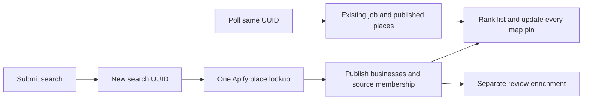

# Live search and map fix

Verified October 25, 2026, Vancouver time.

## What went wrong

I traced the University Avenue, Waterloo search through the database and Apify. Google Maps had returned businesses. The app was failing to publish and display them promptly.

The original Apify run, `5fMg0hsdBydJhd7j9`, finished successfully with 20 businesses. The discovery worker requested reviews and processed one restaurant at a time through Claude before advancing. Review validation could delay or stop publication of the remaining places. The interface could then present an unfinished search as an empty area.

There were several related problems:

- Identical requests could reuse a successful job for 24 hours. Clicking Search again did not necessarily start another scrape.
- When cached places existed, discovery could refresh only those places instead of looking for new ones.
- A fresh dish search could be discarded because its exact words were absent from a business name. That could also prevent the business from ever reaching review enrichment.
- Some Asian fusion and Vietnamese places were excluded before model evidence was available, despite clear source categories.
- After the first partial results appeared, newly discovered places could remain behind the Apply update button.
- The map was recreated on result changes, and its fit logic did not account for a desktop-to-phone resize.
- The location service could rank a similarly named street in another city above Waterloo. The actual selected Waterloo street was correct, but the result ordering was confusing.

## What happens now

### Each submitted search starts fresh

Every restaurant search, confirmed area selection, map-area search, repeated Search click, and filter change creates a new `searchId`. That ID starts a new Apify Google Maps lookup, even if the same query was just searched and matching places are already cached.

Typing alone does not scrape. Area text is resolved into location choices first; choosing an area starts its restaurant search.

Polling reuses the same ID. It reads the existing job and can publish more results, but cannot start another paid lookup. This remains true after success, failure, a spending limit, or an uncertain provider launch. Another deliberate submission gets a new ID.

Search endpoints reject requests without a search ID rather than silently falling back to the previous 24-hour search cache. The older cache policy remains available for noninteractive maintenance work.

### Places appear before review analysis

| Work | Source limit | Reviews | Publication |
| --- | --- | --- | --- |
| Favorite restaurant lookup | 5 businesses | 0 | Available businesses immediately |
| Nearby discovery | 20 businesses | 0 | Available businesses immediately |
| Background food evidence | Up to 20 business URLs | Up to 40 per business | Separate review job |

Favorite and discovery jobs take priority over review jobs. Available source rows are published while Apify is still running. Review processing starts separately after places are available, so a slow or rejected interpretation cannot hold the map empty.

Each published place is linked to its originating search job. A live search for a dish can therefore retain Google's matches without requiring the dish's exact spelling in every restaurant name. Subscriber checks protect access to these search snapshots; clients cannot forge source membership.

### The list and map update together

New place IDs appear automatically. Existing rows keep their relative order while the person browses. A later change to the ranking of already displayed places offers Apply, but newly found places are never hidden behind it. Once the source search completes, cached places absent from its final snapshot are removed.

The map keeps one MapLibre instance, updates its markers, and fits the bounds of all displayed places. The fit includes map dimensions, so switching to a phone layout recalculates the bounds. Numbered pins match list positions, and an accessible location list exposes every displayed place and its coordinates.

On phones, Show map opens the same result set. If a map background cannot load, the coordinate list remains available with an explicit explanation.

### Empty and failed searches are different

Pending searches show progress. The first available places fill a cold area automatically. Failures, missing jobs, service errors, and waiting limits report an unfinished search while retaining any usable results. Only a completed source search with no matching places produces a genuine empty state.

Location choices are ranked by how well they match the words the person entered, including the city. Waterloo now precedes similarly named streets elsewhere for “University Avenue Waterloo.” Street centroids can still be some distance from a particular campus or intersection, so the full location label remains visible.

## Live verification

I submitted the same Waterloo area twice with different search IDs. Both runs used the real authenticated app API and Apify's Google Maps scraper.

| Submission | Apify run | State | Source businesses | Reviews requested | Source charge |
| --- | --- | --- | --- | --- | --- |
| First | `sWoDykkf48mLV1f8M` | Succeeded | 20 | 0 | $0.1002 |
| Repeated same area | `ga5uXPNjpOBTouaVN` | Succeeded | 20 | 0 | $0.1002 |

The selected area was University Avenue, Waterloo, Ontario, at approximately `43.517834, -80.517859`, with a 5 km radius. After cuisine, distance, and availability filtering, the API returned 14 places. A real browser check using the configured MapTiler key verified 14 MapLibre pins on desktop and 14 on phone, with every pin inside the map bounds at both sizes. The checks used a temporary acceptance account, which was removed afterward.

The two place lookups cost $0.2004 combined. Review enrichment is billed separately. These are observed test results, not promises of identical counts or prices on future searches.

## Engineering details



The app sends the same `searchId` on the initial request and every progress request. A new submission must generate a new UUID, including when its text and location are unchanged.

```json
{
  "searchId": "a-new-UUID-for-this-submission",
  "lat": 43.517834,
  "lng": -80.517859,
  "radiusKm": 5,
  "mode": "for-you",
  "query": "",
  "cuisine": ""
}
```

The durable key is based on job kind and search ID. It does not change when the set of places awaiting enrichment shrinks. The database reuses terminal outcomes for that identity, preventing failed-job polling from launching more paid work.

The response keeps the place-search `job` separate from `enrichmentJob` and reports `searchPhase` as `places`, `reviews`, or `complete`. Restaurant ranking still treats missing food evidence neutrally. Google stars remain separate from the personal ranking.

Migrations `20261026055732_logical_search_idempotency.sql` and `20261026060808_search_result_membership.sql` are applied to the East Eats project. The updated hosted worker is deployed. New RPCs use explicit grants, a fixed search path, subscriber checks, and service-only source writes.

## Checks and reproduction

The automated suite covers fresh IDs for repeated searches, same-ID polling, delayed and failed searches, stale responses, partial results growing without Apply, source-query membership, cuisine eligibility, and complete map bounds. The rollback-only database check in `tests/sql/logical-search.sql` verifies terminal replay, new-submission behavior, membership deduplication, and access denial for unrelated callers.

`scripts/verify-waterloo-live.ts` performs the paid-provider and real-map acceptance check. It is excluded from CI and guarded against accidental repeats. `--resume` reuses its saved search IDs for another map check. Local proof and screenshots are saved under `.local/` and are not committed with credentials or session data.

To try it: refresh East Eats, choose Change area, enter “University Avenue Waterloo,” select the Waterloo, Ontario result, then open Show map on a phone. Submitting the same search again starts another source lookup.

## Limits

All matching places means the valid, filtered businesses returned by the bounded search, not every restaurant in a city. Discovery currently requests up to 20 businesses per run; favorite lookup requests up to five. The existing $1 per-Actor cap, database spending ceilings ($120 Apify and $40 Anthropic), and daily refresh-job limit remain in force. Repeated deliberate searches now consume additional credits by design.

Review enrichment can fail independently while places stay usable. Missing evidence remains neutral rather than becoming an invented food-quality claim.

References: [Apify Google Maps input](https://apify.com/compass/crawler-google-places/input-schema), [MapTiler geocoding](https://docs.maptiler.com/cloud/api/geocoding/), and [MapLibre map bounds](https://maplibre.org/maplibre-gl-js/docs/API/classes/Map/#fitbounds).
